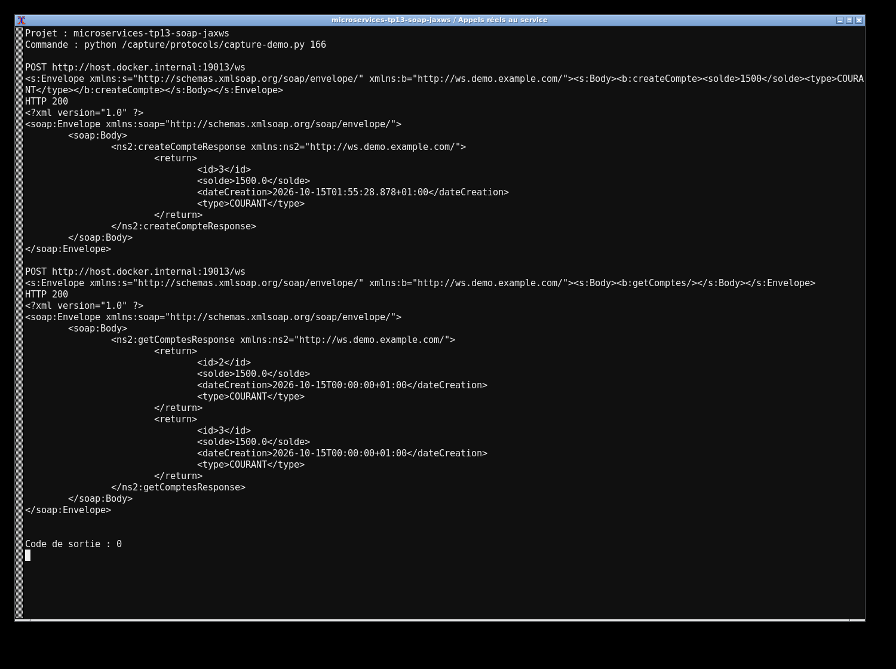
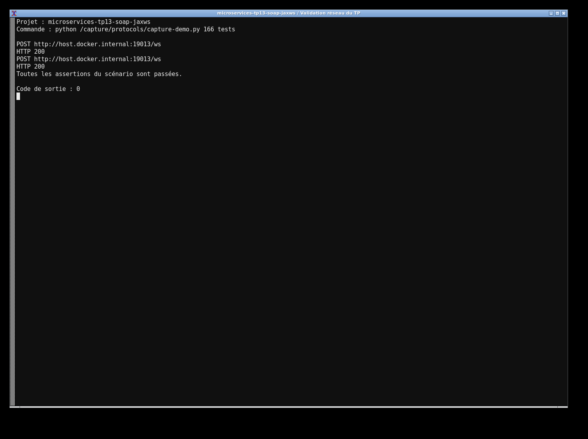

# TP13 — Banque SOAP avec Spring Boot

Ce projet expose les opérations `getComptes`, `getCompteById`, `createCompte` et `deleteCompte` avec JAX-WS et Apache CXF 4.0.2. Les comptes sont enregistrés dans H2 avec Spring Data JPA et transformés en XML par JAXB. Les types disponibles sont COURANT et EPARGNE.

```bash
mvn clean verify
mvn spring-boot:run
```

Le contrat est disponible sur `http://localhost:8082/ws?wsdl`. On peut l’importer dans SoapUI, ou ouvrir le projet fourni dans `soapui/`. Des enveloppes de requêtes sont aussi disponibles dans `requests/`. La console H2 utilise `jdbc:h2:mem:testdb`, utilisateur `sa`, sans mot de passe.

Les six tests envoient de vrais messages SOAP : création, lecture, suppression, contrat WSDL, alias Android `/services/ws` et rejet d’un solde invalide. Le refus ne doit pas ajouter de compte.

J’utilise Java 17 et Boot 3.2.12. Les dépendances JAXB/JAX-WS sont alignées sur Jakarta EE 9.1 pour garder le CXF demandé compatible.



